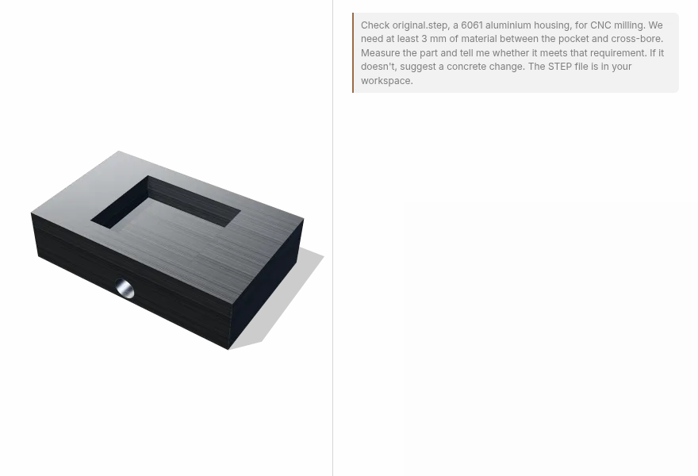

# CAD MCP Server

[](https://npmjs.com/package/cad-mcp-server)
[](https://npmjs.com/package/cad-mcp-server)
[](https://github.com/mattmohandiss/cad-mcp-server/blob/main/LICENSE)
[](https://github.com/mattmohandiss/cad-mcp-server/actions/workflows/ci.yml)

An MCP server that measures STEP CAD files for an AI assistant: overall size and volume, hole and boss diameters, wall thickness, clearance, draft, cross-sections, and differences between two revisions. Measurements are computed by the Open CASCADE kernel from the model's own geometry.



## Quick start

Add the server to your MCP client, then point your assistant at a STEP file:

```json
{
  "mcpServers": {
    "cad": {
      "command": "npx",
      "args": ["-y", "cad-mcp-server"]
    }
  }
}
```

Works with any MCP client, including Claude Desktop, Cursor, and VS Code.

## Example prompts

- "What are the overall dimensions and volume of this part?"
- "Find the cylindrical faces and list their diameters and axes."
- "Measure wall thickness on these faces and report it in millimetres."
- "What is the minimum distance between this hole and the nearest wall?"
- "Measure draft relative to the +Z direction and list faces with negative draft."
- "Cut a section through this body at X = 40."
- "What changed between revision A and revision B?"

More examples, including DFM-style review prompts, are in [docs/EXAMPLE_PROMPTS.md](https://github.com/mattmohandiss/cad-mcp-server/blob/main/docs/EXAMPLE_PROMPTS.md).

## Tools

| Tool            | Returns                                                                                                                    |
| --------------- | -------------------------------------------------------------------------------------------------------------------------- |
| `inspect`       | Bounding-box dimensions, volume, surface area, body and assembly structure, B-rep health, and a revision-bound reference.  |
| `find_entities` | Faces, edges, vertices, and bodies, with filters for surface type, radius, axis, and area.                                 |
| `measure`       | Distance between faces, wall thickness, draft, ray casts, ray grids, point analysis, planar sections, and edge continuity. |
| `diff`          | Dimension, volume, area, and topology deltas between two STEP revisions, plus parsed STEP metadata.                        |

Measurement kinds are `distance`, `thickness`, `draft`, `ray`, `ray_grid`, `point_analysis`, `section`, and `continuity`. Lengths are millimetres and angles are degrees.

Results are reproducible: the server returns the entity IDs and the SHA-256 revision each measurement came from, and rejects stale IDs when a file changes underneath a session. It reports geometry; whether a part is manufacturable remains an engineering judgment.

## Requirements

- Node.js 24+
- Windows x64, macOS ARM64 (Apple Silicon), or Linux x64
- STEP files, as exported by SolidWorks, Fusion 360, Onshape, FreeCAD, CATIA, or any other CAD system

## FAQ

**Does it need CAD software installed?** No. It reads STEP files directly, so it works on a machine without a CAD application or license.

**Do my files leave my machine?** No. The server runs locally over stdio and reads files by path. It is read-only and never writes to your CAD data.

**How is this different from asking an assistant to look at a screenshot?** Measurements are computed from the model's B-rep geometry by Open CASCADE, so the same file and query return the same numbers. Each result also carries the entity IDs and revision it came from.

**What if a STEP file fails to import?** STEP export varies between CAD systems. If a file does not import, open an [issue](https://github.com/mattmohandiss/cad-mcp-server/issues) with the producer and version.

## Documentation

- [Example prompts](https://github.com/mattmohandiss/cad-mcp-server/blob/main/docs/EXAMPLE_PROMPTS.md)
- [Architecture](https://github.com/mattmohandiss/cad-mcp-server/blob/main/docs/ARCHITECTURE.md) — tools, workflow, and limits
- [Security](https://github.com/mattmohandiss/cad-mcp-server/blob/main/docs/SECURITY.md) — local processing and handling CAD files as sensitive input
- [Development](https://github.com/mattmohandiss/cad-mcp-server/blob/main/docs/DEVELOPMENT.md) — source setup, checks, packaging, and releases
- [Changelog](https://github.com/mattmohandiss/cad-mcp-server/blob/main/CHANGELOG.md)

## License

MIT. The bundled Open CASCADE sidecar uses LGPL-2.1. See [THIRD_PARTY_NOTICES.md](https://github.com/mattmohandiss/cad-mcp-server/blob/main/THIRD_PARTY_NOTICES.md).
